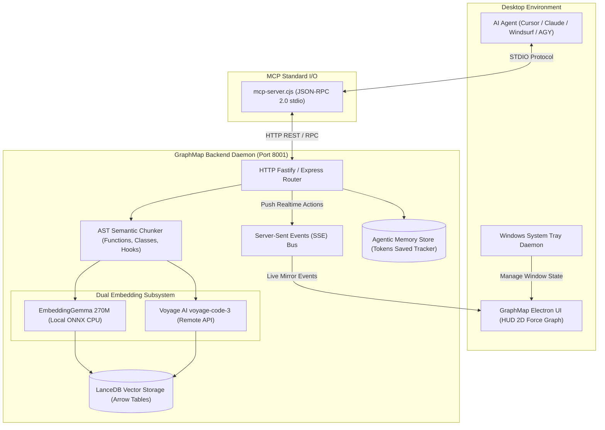

<div align="center">

# GraphMap 🧠⚡
### Visual Embedding Intelligence, Neural Graph Exploration & MCP Memory Server for AI Coding Agents

[](https://github.com/duvanCodexx/GraphMap/releases)
[](https://modelcontextprotocol.io/)
[](https://www.electronjs.org/)
[](https://lancedb.com/)
[](LICENSE)

<br/>

<p align="center">
  <b>GraphMap</b> is a high-performance desktop intelligence platform and 24/7 background daemon that bridges <b>AI Coding Agents</b> (Cursor, Windsurf, Claude Code, Trae, Antigravity) with <b>deep AST semantic chunking</b>, <b>on-device vector search</b>, and an <b>interactive 2D neural knowledge graph</b>.
</p>

[📥 Download Windows Installer](#-windows-installer--quick-start) •
[🔄 Background Daemon](#-background-operation--system-tray) •
[🧠 Embedding Engine](#-dual-embedding-intelligence-engine) •
[🔌 MCP Setup](#-model-context-protocol-mcp-integration) •
[📊 HUD & Mirroring](#-cybernetic-hud--visual-mirroring) •
[🏗️ Architecture](#-system-architecture)

---

</div>

## 📑 Table of Contents
- [🌟 Key Highlights](#-key-highlights)
- [📥 Windows Installer & Quick Start](#-windows-installer--quick-start)
- [🔄 Background Operation & System Tray](#-background-operation--system-tray)
- [🧠 Dual Embedding Intelligence Engine](#-dual-embedding-intelligence-engine)
- [🔌 Model Context Protocol (MCP) Integration](#-model-context-protocol-mcp-integration)
- [🖥️ Cybernetic HUD & Visual Mirroring](#-cybernetic-hud--visual-mirroring)
- [🏗️ System Architecture](#-system-architecture)
- [🌐 REST API Reference](#-rest-api-reference)
- [🛠️ Building from Source](#-building-from-source)
- [📜 License](#-license)

---

## 🌟 Key Highlights

- **⚡ AST-Aware Functional Chunking**: Breaks codebases down into cohesive functions, classes, components, and hooks. Never cuts logical blocks mid-statement; preserves exact line ranges (`L12-L48`) and execution scope.
- **🔄 24/7 Background System Tray Daemon**: Operates silently in the Windows system notification tray. Closing the window keeps the LanceDB vector database, local HTTP server (`127.0.0.1:8001`), and MCP standard I/O channel active for coding assistants.
- **🧠 Hybrid Vector Engine**:
  - **Local Gemma (ONNX Runtime)**: 100% offline, zero-telemetry local inference using `embeddinggemma-270m` with Matryoshka Representation Learning (MRL) dimension truncations (256D, 512D, 768D, 1024D).
  - **Voyage AI Remote**: State-of-the-art `voyage-code-3` (1024D) specialized for source code comprehension and cross-file reference mapping.
- **💾 Long-Term Agentic Memory (`store_memory` / `recall_memory`)**: Saves 70% to 95% of prompt context tokens by retaining architectural summaries and high-level design decisions across agent sessions.
- **🔥 Hot Micro-Reindexing (`reindex_file`)**: When your agent creates or updates a file, it reindexes only that isolated delta in milliseconds without reprocessing the whole project.
- **🎨 Cybernetic 2D Neural HUD**: Force-directed graph rendered via WebGL/Canvas with live Server-Sent Events (SSE) mirroring every query, retrieval, and memory injection executed by AI agents in real time.
- **📐 Native Desktop Snap**: Snaps to exact quarter-screen corners (Bottom-Right, Top-Right) with Always-on-Top capability, designed for seamless side-by-side pair programming alongside your code editor.

---

## 📥 Windows Installer & Quick Start

### Direct Download
The official 64-bit installer for Windows 10/11 is published and distributed via official GitHub Releases:

👉 **[Download Latest GraphMap-Setup from Releases](https://github.com/duvanCodexx/GraphMap/releases)**

### Installation Steps
1. Download `GraphMap-Setup-1.0.0-x64.exe`.
2. Run the installer. Choose your preferred installation directory.
3. The installer creates Start Menu shortcuts and a Desktop launcher.
4. Launch **GraphMap**. The local vector server will automatically initialize on port `8001`.

---

## 🔄 Background Operation & System Tray

GraphMap is engineered to stay available without occupying screen space or taskbar clutter:

| Feature | Behavior |
|---|---|
| **Close to Tray (X)** | Clicking `X` or pressing `Alt+F4` immediately hides the window to the Windows System Tray while keeping the vector database and MCP service alive. |
| **System Tray Icon** | Right-click the GraphMap tray icon for quick actions: Open HUD, Hide HUD, Port Status (`http://127.0.0.1:8001`), Run in Background toggle, Run at Windows Startup toggle, and Quit Completely. |
| **Double Click Restore** | Double-clicking the tray icon restores and focuses the window instantly. |
| **Start with Windows** | Configurable directly from Settings or the Tray context menu via Windows Login Item Settings. |

```
[Windows System Tray] -> 🧠 GraphMap Active (Port 8001)
                      ├── Abrir GraphMap
                      ├── Ocultar en segundo plano
                      ├── Puerto Backend: 8001
                      ├── MCP Activo: mcp-server.cjs
                      ├── ✓ Ejecutar en segundo plano al cerrar
                      ├── Iniciar con Windows
                      └── Salir completamente
```

---

## 🧠 Dual Embedding Intelligence Engine

GraphMap features a decoupled embedding subsystem supporting both local offline privacy and cloud-accelerated models:

### 1. Local Offline Engine (EmbeddingGemma ONNX)
- **Model**: `google/embeddinggemma-270m`
- **Inference**: Native ONNX Runtime with CPU acceleration. No external Python or PyTorch installation required.
- **Matryoshka Representation Learning (MRL)**: Choose between **256D**, **512D**, **768D**, or **1024D** vectors to balance RAM usage and precision.
- **Integrated Downloader**: One-click download directly from Hugging Face with progress tracking and automatic SHA validation.

### 2. Voyage AI Remote Engine
- **Model**: `voyage-code-3` (1024D)
- **Network Resilience**: Equipped with IPv4-first DNS resolution, 35-second abort timeouts, and exponential retry backoffs to overcome corporate proxies and Windows network adapters.

### 3. Dimension Compatibility Shield
LanceDB vector tables enforce strict dimensional integrity. GraphMap automatically reads the active project's schema and alerts the user if a switch between mismatched dimension configurations occurs, preventing database corruption.

---

## 🔌 Model Context Protocol (MCP) Integration

GraphMap exposes a native JSON-RPC 2.0 stdio MCP server located at `mcp-server.cjs`.

### Client Configurations

#### 1. Cursor (`.cursor/mcp.json`)
```json
{
  "mcpServers": {
    "graphmap": {
      "command": "node",
      "args": ["C:/Users/duvan/Documents/EMBEDING-ELECTRON/mcp-server.cjs"]
    }
  }
}
```

#### 2. Claude Desktop (`claude_desktop_config.json`)
```json
{
  "mcpServers": {
    "graphmap": {
      "command": "node",
      "args": ["C:/Users/duvan/Documents/EMBEDING-ELECTRON/mcp-server.cjs"]
    }
  }
}
```

#### 3. Windsurf / Trae / Google Antigravity (AGY)
```json
{
  "mcpServers": {
    "graphmap": {
      "command": "node",
      "args": ["C:/Users/duvan/Documents/EMBEDING-ELECTRON/mcp-server.cjs"]
    }
  }
}
```

#### 4. Claude Code CLI
```bash
claude mcp add graphmap node C:/Users/duvan/Documents/EMBEDING-ELECTRON/mcp-server.cjs
```

### Available MCP Tools

| Tool | Parameters | Description |
|---|---|---|
| `search_code` | `query` *(string)*, `top_k` *(number)* | Semantic search over indexed functions, classes, and code chunks with cosine similarity and line numbers. |
| `store_memory` | `key`, `content`, `summary`, `tags`, `file_path` | Stores an architectural pattern or file summary to save context tokens in future sessions. |
| `recall_memory`| `query` *(string)*, `limit` *(number)* | Retrieves previously stored memories using hybrid vector and keyword matching. |
| `list_memories` | *none* | Enumerates all active long-term memories and accumulated token savings. |
| `reindex_file` | `file_path` *(string)* | Hot-reindexes a single file edited by the agent in under 200ms. |
| `reindex_project` | `confirmar` *(boolean)* | Triggers a full background AST reindexing pass across the active codebase. |
| `get_stats` | *none* | Returns vector database statistics, node counts, and token savings metrics. |
| `list_projects`| *none* | Lists all indexed workspaces and repositories configured in the system. |
| `set_active_project` | `project_path` *(string)* | Switches the active vector workspace and loads the corresponding LanceDB table. |

---

## 🖥️ Cybernetic HUD & Visual Mirroring

The frontend interface combines a cyberpunk dark HUD with real-time feedback:

- **AI Live Mirror (SSE)**: As your agent executes `search_code` or `store_memory`, the desktop HUD lights up active nodes, showing the agent's line of focus without interrupting your workflow.
- **Interactive Force Graph**: Powered by `react-force-graph-2d`, supporting zoom, pan, node isolation, file-scope filtering, and semantic proximity clustering.
- **HUD Snap Mode**: Toggle 1/4 screen snap (`Bottom-Right`, `Top-Right`, `Bottom-Left`, `Top-Left`) with Always-on-Top pin to keep a compact monitor beside your editor.

---

## 🏗️ System Architecture



---

## 🌐 REST API Reference

The local server runs at `http://127.0.0.1:8001`. Key endpoints include:

- `POST /search`: Execute semantic search against code chunks (`{ query: string, top_k: number }`).
- `GET /projects`: Retrieve the list of registered projects and their indexing status.
- `POST /projects/select`: Switch the active project context.
- `GET /settings`: Retrieve current embedding engine parameters and dimension modes.
- `POST /settings`: Update provider credentials (Gemma Local, Gemma API, Voyage AI) securely.
- `GET /model/status`: Query local ONNX model download status and readiness.
- `POST /model/download`: Initiate background download of `embeddinggemma-270m` ONNX files.
- `GET /events`: SSE event stream for UI live mirroring.

---

## 🛠️ Building from Source

### Prerequisites
- **Node.js**: v18.0.0 or higher
- **npm**: v9.0.0 or higher
- **Windows**: x64 platform

### Build Commands

```bash
# 1. Clone repository
git clone https://github.com/duvanCodexx/GraphMap.git
cd GraphMap

# 2. Install dependencies
npm install

# 3. Run development mode (Vite + Electron)
npm run dev

# 4. Generate application icons
node scripts/generate-icons.cjs

# 5. Build production Windows NSIS installer
npm run build
```

The resulting installer package is generated compressed at:
`release/GraphMap-Setup-1.0.0-x64.zip`

---

## 📜 License

GraphMap is open-source software licensed under the **[MIT License](LICENSE)**.

<div align="center">
<sub>Crafted with precision for AI pair-programming and neural code search.</sub>
</div>
